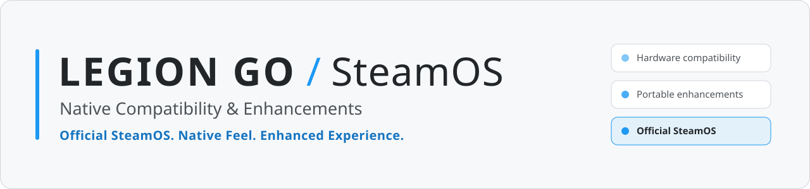
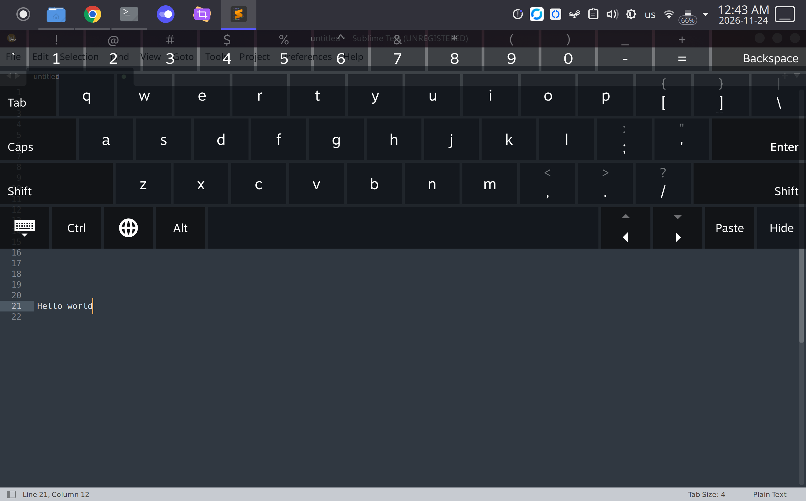
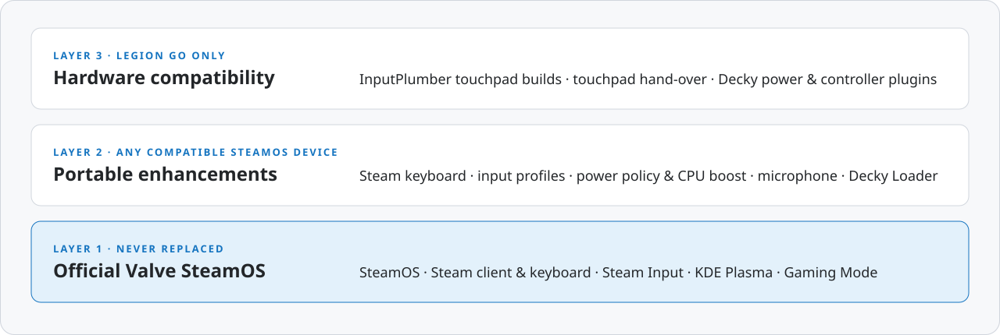

<p align="center">
  <picture>
    <source media="(prefers-color-scheme: dark)" srcset="docs/images/brand/hero-dark.svg">
    
  </picture>
</p>

<p align="center">
  <a href="https://github.com/daineku/legiongosteamos/releases/latest"></a>
  <a href="https://github.com/daineku/legiongosteamos/actions/workflows/ci.yml"></a>
  <a href="LICENSE"></a>
  <a href="docs/COMPATIBILITY.md"></a>
</p>

**Legion Go SteamOS** improves Valve's official SteamOS instead of replacing it. It is a modular set of native enhancements and compatibility fixes, built and verified on the Lenovo Legion Go:
- desktop typing with Valve's own keyboard;
- controller input;
- touchpad precision;
- power behaviour.

Portable enhancements are designed for other SteamOS devices; hardware-specific fixes stay isolated.

> **Preserve what Valve already does well. Improve what the hardware needs. Extend what the software can do.**

Independent community project, not affiliated with Valve, Lenovo or KDE.

## Screenshots

Real screenshots from the reference Legion Go (SteamOS 3.9.5, KDE Plasma Desktop Mode). The keyboard is **Valve's original Steam keyboard**, enhanced by the `steam-keyboard` tweak.

| Bottom placement | Top placement |
|:---:|:---:|
|  |  |
| **Flush, edge to edge, semi-transparent.** The editor and wallpaper stay visible through the keys. The move key replaces Emoji; Ctrl and Alt sit next to 🌐; Hide really closes it. | **One tap moves it under the KDE panel.** The panel stays usable, and the lower half of the screen stays free for the text you are typing. |

## Two joysticks. One native Steam keyboard.

Steam Deck types with Valve's dual-cursor keyboard by using its **two trackpads**. The Legion Go has only one trackpad, but **two analog sticks**, so we adapted Valve's native keyboard to use them instead. Touch input, the desktop pointer and the original Steam keyboard all stay as they are.

| Control (while the keyboard is open) | Action |
|---|---|
| Left stick / right stick | Move the left / right key cursor, independently |
| **LT** | Press the key under the left cursor |
| **R3** (right stick click) | Press the key under the right cursor |
| **RT** | Desktop left click (click into a field without leaving the controller) |
| Touchpad | Desktop pointer |
| Touchscreen | Direct typing |
| D-pad | Arrow keys |

When the keyboard closes, the controller behaves normally again. On a Steam Deck, Steam's own dual-trackpad typing stays untouched. On other handhelds, the bridge is enabled only when the controller is detected as a compatible virtual Steam Deck controller (InputPlumber).

## Typing that works like a real keyboard

| | |
|---|---|
| **Multilingual** | KDE's layout follows the Steam keyboard language, so English and Russian (and other XKB layouts) arrive as real key events, also in Chrome. Your own layout returns on Hide. |
| **Desktop navigation** | Tab / Shift+Tab between fields; Ctrl and Alt for shortcuts on every layout |
| **Long press** | Release on a key for its second symbol (`9` → `(`, `2` → `@`, Russian `3` → `№`), or slide to any entry in Steam's symbol popup |
| **Emoji** | Tap 🌐 to switch language; hold it to open Steam's emoji picker |
| **Multi-touch** | Hold Ctrl or Alt with one finger and tap another key (Alt+Tab, Ctrl+C); tap once for one key, twice to lock |
| **Backspace hold** | Characters (accelerating) in terminals, whole words in text fields |
| **Placement** | Bottom by default, top under the KDE panel with one tap; Hide closes it without unwanted reopening |
| **Transparency** | Valve's own colours, slightly see-through, so the desktop stays readable |

## Enhancements

Each tweak installs separately, verifies that it works, and can be rolled back. All seven are **Reference Verified** on our Legion Go; the exceptions are noted in each guide.

**Input & controller**
- [**steam-keyboard**](tweaks/steam-keyboard/): everything above. *Portable: any SteamOS device with KDE Desktop Mode.*

**SteamOS software**
- [**mic-enhance**](tweaks/mic-enhance/): fuller internal microphone that does not clip. *Portable by capability.*
- [**decky-loader**](tweaks/decky-loader/): Decky plugin loader from a pinned, checksum-verified release. *Portable.*

**Performance & power**
- [**desktop-power-policy**](tweaks/desktop-power-policy/): responsive desktop with CPU boost kept on and a balanced energy preference; lower idle draw on battery; Gaming Mode left to Steam. *Portable by capability (EPP, CPU boost or Lenovo firmware profiles).*

**Legion Go hardware**
- [**precision-touchpad**](tweaks/precision-touchpad/): smoother touchpad (≈ 106 instead of ≈ 42 updates/s), optional precise tap-to-click.
- [**desktop-touchpad**](tweaks/desktop-touchpad/): the touchpad keeps working when Steam is closed.
- [**decky-power-plugins**](tweaks/decky-power-plugins/): per-game TDP and Legion Go controls in Gaming Mode, with safe defaults. (Remapping, fans, RGB and charge limit: not yet verified.)

## Architecture

<picture>
  <source media="(prefers-color-scheme: dark)" srcset="docs/images/brand/architecture-dark.svg">
  
</picture>

- **Official SteamOS** is never modified on disk.
- **Portable enhancements** detect capabilities (drivers, interfaces, input devices), not device names.
- **Legion Go hardware** tweaks check the device identity, and `--force` cannot override that.

Details: [docs/ARCHITECTURE.md](docs/ARCHITECTURE.md).

## Install

Open **Konsole** in Desktop Mode and paste. This installs the keyboard enhancement:

```bash
d=~/.local/share/legiongo-steamos/v0.2.3
{ [ -d "$d" ] || git -c advice.detachedHead=false clone -q --depth 1 -b v0.2.3 https://github.com/daineku/legiongosteamos.git "$d"; } &&
"$d/legiongo.sh" install steam-keyboard
```

Precision touchpad (Legion Go):

```bash
d=~/.local/share/legiongo-steamos/v0.2.3
{ [ -d "$d" ] || git -c advice.detachedHead=false clone -q --depth 1 -b v0.2.3 https://github.com/daineku/legiongosteamos.git "$d"; } &&
"$d/legiongo.sh" install precision-touchpad
```

For any other tweak, replace the name at the end. What the command does:
- Fetches the fixed release `v0.2.3` into a folder you can inspect.
- Checks your device.
- Asks before anything that needs your password or another tweak.
- Installs and tests the tweak, then reports one of three results:
  - **INSTALLED & VERIFIED**;
  - **INSTALLED — VERIFICATION PENDING** (it cannot be tested right now, e.g. outside Desktop Mode);
  - **FAILED**, in which case everything is rolled back.

| Task | Command (after the first install) |
|---|---|
| List tweaks and their state | `~/.local/share/legiongo-steamos/v0.2.3/legiongo.sh list` |
| Health report (no personal data) | `… doctor` |
| Is it working? | `… status <tweak>` |
| Update one tweak | the install line with `update` |
| Remove one tweak | the install line with `uninstall` |

Tweaks that change system files ask for your `sudo` password; on SteamOS, set one once with `passwd`. More in [docs/INSTALLATION.md](docs/INSTALLATION.md).

## Compatibility

| Device | Portable tweaks | Legion Go tweaks |
|---|---|---|
| Lenovo Legion Go (1st gen), SteamOS 3.9.5 | **Reference Verified** | **Reference Verified** |
| Steam Deck LCD / OLED | compatible by capability, untested (keyboard: Steam's own trackpad typing stays) | not applicable |
| Other handhelds on official SteamOS | compatible by capability, untested | not applicable |

No feature has been tested on a second device yet; reports are welcome. `check <tweak>` explains why a tweak is unavailable. Full matrix: [docs/COMPATIBILITY.md](docs/COMPATIBILITY.md).

## Performance

Measured on the reference device. Unfavourable numbers are included.

| | Result |
|---|---|
| Touchpad updates (precision-touchpad) | ≈ 42 → ≈ 106 per second |
| Tap moves the cursor ≥ 5 px (`tapfilter` variant) | 36 % → 7 % of taps |
| Desktop idle on battery (power policy) | 7.86 W → 7.11 W |
| CPU boost on vs off (sustained 16-process work) | 7 % faster, ≈ +3 °C; idle draw within noise |
| Keyboard helper, touchpad hand-over, power policy, mic filter | 0.00 % CPU at idle (event-driven) |
| **Trade-off:** InputPlumber 0.84 (needed for 106 Hz) | 6.3 % vs 3.1 % CPU of one core at idle; battery impact not isolated |

Some tweaks trade a little processing for responsiveness, and not every tweak saves power. Details and conditions: [docs/PERFORMANCE.md](docs/PERFORMANCE.md).

## Documentation

[Installation](docs/INSTALLATION.md) · [Compatibility](docs/COMPATIBILITY.md) · [Performance](docs/PERFORMANCE.md) · [Troubleshooting](docs/TROUBLESHOOTING.md) · [Architecture](docs/ARCHITECTURE.md) · [Third-party components](docs/THIRD_PARTY.md) · [Maintaining](docs/MAINTAINING.md) · [Audit](docs/DEVELOPMENT_AUDIT.md) · [Test report](docs/TEST_REPORT.md) · [Contributing](CONTRIBUTING.md) · [Changelog](CHANGELOG.md)

## License and disclaimer

GPL-3.0-or-later.
- The InputPlumber patches derive from [InputPlumber](https://github.com/ShadowBlip/InputPlumber) (GPL-3.0).
- The LegionGoRemapper patch derives from [LegionGoRemapper](https://github.com/aarron-lee/LegionGoRemapper) (BSD-3-Clause).
- No Valve, Lenovo or KDE files or logos are distributed.

Lenovo, Legion, Valve, Steam, SteamOS, KDE and Plasma are trademarks of their respective owners. This project is provided as is, without warranty.
