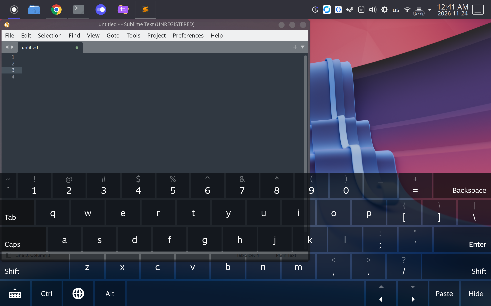

# Legion Go SteamOS — Native Compatibility & Enhancements

**Official SteamOS. Native feel. Enhanced performance.**

Legion Go SteamOS is a modular collection of compatibility fixes and native software enhancements for **Valve's official SteamOS**.

It is built and verified on the Lenovo Legion Go. It improves desktop interaction, controller input, keyboard usability, power efficiency and hardware integration, and it does so without replacing SteamOS or anything Valve ships. Portable enhancements are designed for other compatible SteamOS devices; hardware-specific tweaks stay isolated to the hardware they were built for.

The aim: keep the stability of official SteamOS, remove its handheld usability gaps, and make everyday use more polished, responsive and efficient.

> Community project. Not affiliated with or endorsed by Valve or Lenovo.

## Architecture

```
┌──────────────────────────────────────────────────────────────────────────┐
│ Layer 3 — Legion Go hardware compatibility                    (Legion Go)│
│   InputPlumber touchpad builds · touchpad hand-over · Lenovo WMI plugins │
├──────────────────────────────────────────────────────────────────────────┤
│ Layer 2 — Portable enhancements                (any compatible SteamOS)  │
│   Steam keyboard · input profiles · power policy & CPU boost · mic · Decky│
├──────────────────────────────────────────────────────────────────────────┤
│ Layer 1 — Native SteamOS                                 (never replaced)│
│   SteamOS · Steam client & keyboard · Steam Input · KDE Plasma · Gaming  │
└──────────────────────────────────────────────────────────────────────────┘
```

- **Nothing in Layer 1 is replaced or patched on disk.** The keyboard is still Valve's keyboard, Steam Input is still in charge, and SteamOS updates keep working.
- **Layer 2** checks for capabilities (drivers, interfaces, input devices), not device names.
- **Layer 3** checks the Lenovo Legion Go hardware identity and refuses to run anywhere else. `--force` cannot override that.

## Tweaks

Every tweak installs with one command, can be checked and rolled back, and is **Reference Verified**: its behaviour was confirmed on our reference Legion Go (SteamOS 3.9.5), and its installer passes isolated install, reinstall, failure and rollback tests. Per-feature exceptions are listed in each guide.

### Input & controller experience
| Tweak | What you notice | Runs on |
|---|---|---|
| [**steam-keyboard**](tweaks/steam-keyboard/) | Valve's on-screen keyboard becomes a practical desktop typing tool:<br>• proper placement and a real Hide key<br>• Ctrl/Alt and Tab between fields<br>• typing in any configured language<br>• **dual-joystick typing** on the Legion Go | any SteamOS device with KDE Desktop Mode (dual-joystick: InputPlumber handhelds) |

### SteamOS software enhancements
| Tweak | What you notice | Runs on |
|---|---|---|
| [**mic-enhance**](tweaks/mic-enhance/) | The internal microphone sounds fuller and does not clip | devices with one internal analog microphone |
| [**decky-loader**](tweaks/decky-loader/) | Decky plugin menu, from a pinned and verified release | any SteamOS device |

### Performance & power efficiency
| Tweak | What you notice | Runs on |
|---|---|---|
| [**desktop-power-policy**](tweaks/desktop-power-policy/) | The desktop stays responsive (CPU boost kept on, balanced EPP) and draws less on battery; Gaming Mode is left alone | devices with EPP, CPU boost control or Lenovo firmware profiles |

### Legion Go hardware compatibility
| Tweak | What you notice | Runs on |
|---|---|---|
| [**precision-touchpad**](tweaks/precision-touchpad/) | Smoother touchpad (≈106 instead of ≈42 updates/s), optional precise tap-to-click | Lenovo Legion Go (1st gen) |
| [**desktop-touchpad**](tweaks/desktop-touchpad/) | Touchpad keeps working when Steam is closed | Lenovo Legion Go (1st gen) |
| [**decky-power-plugins**](tweaks/decky-power-plugins/) | Per-game TDP and Legion Go controls in Gaming Mode, with safe defaults and safety fixes | Lenovo Legion Go (1st gen) |

## Screenshots

Real screenshots from the reference Legion Go (Desktop Mode, SteamOS 3.9.5). The keyboard is Valve's own Steam keyboard, with the `steam-keyboard` enhancement:

| Bottom position | Top position |
|---|---|
|  |  |
| Flush with the bottom edge and edge to edge; the editor and wallpaper show through the semi-transparent keys. The move key (bottom left) replaces Emoji; Ctrl and Alt sit next to 🌐; Hide closes it. | Moved to the top with one tap, directly under the KDE panel, so the text being typed at the bottom of the editor stays visible. |

## Dual-joystick typing: Steam's dual-cursor keyboard, adapted to the Legion Go

On a Steam Deck, Valve's keyboard is typed with the **two trackpads**: each thumb steers its own cursor over half of the keyboard.

Unlike Steam Deck, the Lenovo Legion Go has only **one trackpad**. Our keyboard enhancement adapts Steam's native dual-cursor typing to the device's **two analog joysticks**, so you can type comfortably with the controller without replacing Valve's keyboard:

| Control while the keyboard is open | Action |
|---|---|
| Left stick / right stick | Move the left / right key cursor (independently) |
| Left trigger (LT) | Press the key under the left cursor (right click when no cursor is active) |
| Right stick click (R3) | Press the key under the right cursor |
| Right trigger (RT) | Desktop left click, so you can click into a text field without leaving the controller |
| Touchscreen | Works as usual |
| Touchpad | Stays the desktop mouse |
| D-pad | Arrow keys |

Normal controller behaviour returns as soon as the keyboard closes. On a Steam Deck, the bridge stays off and Steam's own dual-trackpad typing is used; the installer detects which profile applies.

## Install — one command

Open **Konsole** in Desktop Mode and paste the line for the tweak you want, for example:

```bash
d=~/.local/share/legiongo-steamos/v0.2.2-beta; { [ -d "$d" ] || git -c advice.detachedHead=false clone -q --depth 1 -b v0.2.2-beta https://github.com/daineku/legiongosteamos.git "$d"; } && "$d/legiongo.sh" install steam-keyboard
```

Replace `steam-keyboard` with any tweak id above. The command:
1. Downloads this project at the fixed release `v0.2.2-beta` into `~/.local/share/legiongo-steamos/`, a folder you can inspect.
2. Checks your device.
3. Explains and asks before anything that needs your password or another tweak.
4. Installs the tweak and **verifies that it works**. If verification fails, everything is rolled back.

**Uninstall:** the same line with `uninstall`.

**Update one tweak:** the same line from a newer release with `update`.

**Health check:** `doctor` prints a report with no personal data.

Tweaks that change system files ask for your `sudo` password. SteamOS has none by default: set one once with `passwd`.

## Lightweight by design

Measured on the reference device, idle, keyboard closed (details: [docs/PERFORMANCE.md](docs/PERFORMANCE.md)):

| Component | Runs | CPU (one core) | Memory |
|---|---|---|---|
| Keyboard helper | Desktop session only | 0.00 % (keyboard closed); about 3.5 % while the keyboard is open (reads controller reports) | 41 MB |
| Touchpad hand-over | Desktop session only | 0.00 % | 15 MB |
| Power policy | event-driven root service; writes nothing in Gaming Mode | 0.00 % | 39 MB |
| Mic filter | inside PipeWire's existing filter-chain | 0.00 % (mic idle) | 11 MB |
| InputPlumber 0.84 (precision-touchpad) | replaces the stock service | 6.3 % vs 3.1 % stock (cost of the native 106 Hz touchpad driver; our patch adds nothing measurable) | 24 MB vs 21 MB stock |

There is no background updater, no polling helper, and no extra UI framework.

## Compatibility at a glance

| Device | Portable tweaks | Legion Go tweaks |
|---|---|---|
| Lenovo Legion Go (1st gen), SteamOS 3.9.5 | **Reference Verified** | **Reference Verified** |
| Steam Deck LCD / OLED | compatible by capability, untested (the keyboard uses Steam's own dual-trackpad typing there) | not applicable |
| Other handhelds on official SteamOS | compatible by capability, untested | not applicable |

Full matrix: [docs/COMPATIBILITY.md](docs/COMPATIBILITY.md). `check <tweak>` explains exactly why a tweak is unavailable on a device.

## More

[Installation](docs/INSTALLATION.md) · [Compatibility](docs/COMPATIBILITY.md) · [Performance](docs/PERFORMANCE.md) · [Third-party components](docs/THIRD_PARTY.md) · [Troubleshooting](docs/TROUBLESHOOTING.md) · [Maintaining](docs/MAINTAINING.md) · [Architecture](docs/ARCHITECTURE.md) · [Audit](docs/DEVELOPMENT_AUDIT.md) · [Test report](docs/TEST_REPORT.md) · [Wi-Fi research](experimental/wifi-reliability/) · [Contributing](CONTRIBUTING.md) · [Changelog](CHANGELOG.md)

## License

GPL-3.0-or-later. The InputPlumber patches are derived from InputPlumber (GPL-3.0), and the LegionGoRemapper patch from LegionGoRemapper (BSD-3-Clause). No Valve or Lenovo files are distributed. Lenovo, Legion, Valve, Steam and SteamOS are trademarks of their owners. Provided as is, without warranty.
